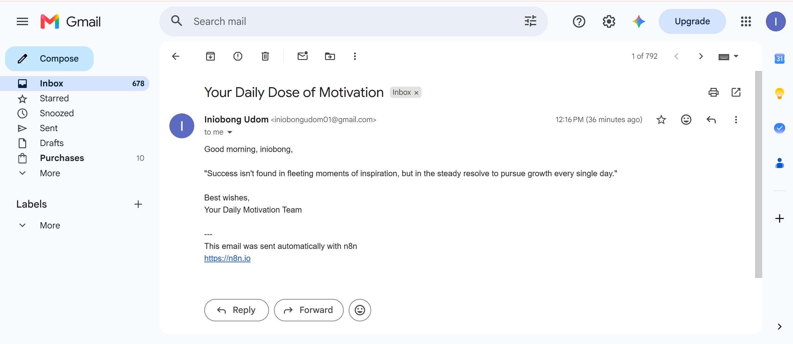

# AI-Powered Daily Motivational Email Automation

An n8n workflow that uses an AI model, Google Sheets, and Gmail to generate and send daily motivational emails automatically at **7:00 AM**.

## Demo

**[Watch the Loom walkthrough](https://www.loom.com/share/3698b08fe74a4a9e8da4990402397cb4)**

## Workflow

`Schedule Trigger → Message a Model → Google Sheets → Gmail`

1. **Schedule Trigger** starts the workflow each morning.
2. **Message a Model** generates original motivational content.
3. **Google Sheets** provides recipient data.
4. **Gmail** sends the email automatically.

## Workflow Screenshots

### n8n workflow

### Successful email delivery

## Download the Workflow

[View or download the sanitized n8n workflow JSON](Daily%20AI%20motivational%20email%20automation.json).

To use it, import the JSON into n8n and configure your own AI, Google Sheets, and Gmail credentials. Replace the placeholder spreadsheet ID with your own sheet ID.

## Tools Used

- n8n — workflow automation
- AI model integration — content generation
- Google Sheets — recipient data source
- Gmail — email delivery

## What This Project Demonstrates

- Scheduled workflow automation
- AI-generated content
- Connecting multiple services in one workflow
- Using spreadsheet data in an automated process
- Automated email delivery

## Business Applications

This pattern can be adapted for recurring reminders, internal updates, customer follow-ups, lead nurturing, and other routine business communications.

## Validation

The workflow was tested, and successful email delivery was confirmed.

## Security Notes

The public workflow export has been sanitized to remove the live spreadsheet ID, account identifiers, and execution-specific identifiers. It does not include credentials or recipient email addresses. Configure your own credentials and spreadsheet before running it.

## Status

Completed and tested as a learning and portfolio project.
